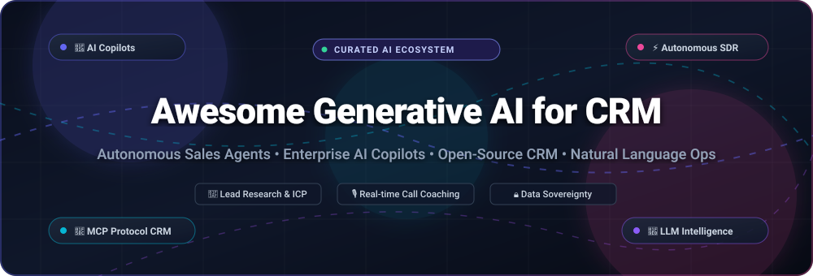

<div align="center">

<a href="https://github.com/ishandutta2007/Awesome-Generative-AI-For-CRM">
  
</a>

<br/><br/>

# 🚀 Awesome Generative AI for CRM

### 🤖 Curated Directory of AI Sales Copilots, Autonomous Agents & AI-Native CRM Systems

<p align="center">
  <a href="https://github.com/ishandutta2007/Awesome-Aeesome-Awesome"></a>
  <a href="https://discord.gg/jc4xtF58Ve"></a>
  <a href="https://github.com/ishandutta2007/Awesome-Generative-AI-For-CRM/stargazers"></a>
  <a href="https://github.com/ishandutta2007/Awesome-Generative-AI-For-CRM/network/members"></a>
  <a href="https://github.com/ishandutta2007/Awesome-Generative-AI-For-CRM/blob/main/LICENSE"></a>
  <a href="https://github.com/ishandutta2007/Awesome-Generative-AI-For-CRM/pulls"></a>
  <a href="https://github.com/isaandutta2007"></a>
</p>

<p align="center">
  <b>A comprehensive, SEO-optimized knowledge repository tracking enterprise SaaS platforms, autonomous SDR agents, and self-hosted open-source software integrating Large Language Models (LLMs) with CRM workflows.</b>
</p>

</div>

---

## 📑 Table of Contents

- [📌 Introduction & Scope](#-introduction--scope)
- [📊 Sector Overview & Market Dynamics](#-sector-overview--market-dynamics)
- [🏢 SaaS & Hosted Platforms](#-saas--hosted-platforms)
- [💻 Open-Source GitHub Projects](#-open-source-github-projects)
- [🧠 Architecture: How Generative AI Powers Modern CRM](#-architecture-how-generative-ai-powers-modern-crm)
- [❓ Frequently Asked Questions (FAQ)](#-frequently-asked-questions-faq)
- [🤝 How to Contribute](#-how-to-contribute)
- [💖 Support & Sponsor](#-support--sponsor)
- [📈 Star History](#-star-history)
- [⚖️ Disclaimer](#-disclaimer)

---

## 📌 Introduction & Scope

**Generative AI for CRM** represents a paradigm shift from passive database record-keeping to **proactive, agentic revenue engines**. Modern Customer Relationship Management systems embedded with Large Language Models (LLMs), Model Context Protocol (MCP) servers, and retrieval-augmented generation (RAG) empower sales, marketing, and customer success teams to:

- 🔍 **Automate Inbound & Outbound Prospecting**: Autonomous SDR agents research prospects, generate ideal customer profiles (ICPs), and craft hyper-personalized outreach.
- 🎙️ **Real-time Call Coaching & Copilots**: On-call sentiment analysis, objection handling prompts, and automated meeting transcription with instant CRM pipeline updates.
- ⚡ **Natural Language CRM Operations**: Query pipelines, generate deals, update stages, and build analytics dashboards using simple conversational English.
- 🛡️ **Data Sovereignty & Local AI**: Run local-first, self-hosted AI CRMs with open models (Llama, Mistral, DeepSeek) without exposing sensitive customer records to per-seat vendor taxes.

---

## 📊 Sector Overview & Market Dynamics

The global market for **Artificial Intelligence in CRM** is estimated at **$11.04 billion in 2025** and is projected to expand to **$51.67 billion by 2030**, registering an aggressive Compound Annual Growth Rate (**CAGR of ~36.1%**), with total global spending on broader Generative AI-enabled CRM ecosystems scaling toward **$170 billion**.

### 🔍 Market Concentration vs. Fragmentation
The sector displays a **bifurcated market structure**:
- **High Enterprise Concentration at the Top**: Legacy enterprise suites (Salesforce, Microsoft Dynamics 365, Oracle Fusion CX, and SAP CX) hold concentrated market dominance among Fortune 500 organizations, relying on massive data graphs and native platform copilot layers (Agentforce, Copilot).
- **Extreme Mid-Market & Open-Source Fragmentation**: The SMB, mid-market, and developer tiers are **highly fragmented and rapidly contested**. Fast-growing AI-native SaaS challengers and extensible open-source platforms (e.g., Twenty, Chatwoot, Cordys CRM, Relaticle) are unbundling legacy per-seat CRM systems by delivering modular MCP servers, local privacy models, and customizable agentic workflows.

---

## 🏢 SaaS & Hosted Platforms

Below is a detailed comparison of leading enterprise Generative AI CRM platforms, sorted in descending order by **Company Size (Market Capitalization / Corporate Valuation)**.

| Company & Platform 🏢 | Company Size (Market Cap / Valuation) 💰 | Starting Pricing Tier 🏷️ | Free Tier Limits & Free Trial Terms 🎁 | Core GenAI & Autonomous Agent Capabilities 🤖 |
| :--- | :--- | :--- | :--- | :--- |
| **[Microsoft Dynamics 365 Copilot](https://www.microsoft.com/en-us/dynamics-365)** | **~$3.1 Trillion** *(Market Cap)* | **$65 / user / month** *(Dynamics 365 Sales Professional; Sales Enterprise with Copilot at $105/user/mo; Copilot for Sales add-on at $50/user/mo)* | **30-Day Free Trial** *(Up to 25 users, pre-loaded sample dataset, full access to Dynamics 365 Sales and embedded Copilot assistance)* | Embedded Copilot across Outlook, Teams, and Dynamics; automated email summaries, real-time meeting coaching, and predictive deal risk insights. |
| **[Oracle Fusion Sales AI](https://www.oracle.com/cx/sales/)** | **~$480 Billion** *(Market Cap)* | **$65 / user / month** *(Professional Edition; Standard Edition at $100/user/mo; enterprise minimum volume commits apply)* | **30-Day Cloud Trial + Guided POC** *(Access via OCI Free Tier with $300 cloud credits, always-free services, and interactive guided demo sandbox tours)* | AI-driven deal acceleration, predictive lead qualification, automated next-best sales action recommendations, and CPQ quote guidance. |
| **[SAP CX AI](https://www.sap.com/products/crm.html)** | **~$290 Billion** *(Market Cap)* | **$60 / user / month** *(SAP Sales Cloud Standard Edition; Enterprise Edition starts at $134/user/mo)* | **30-Day Free Trial** *(Dedicated shared tenant environment pre-populated with master data and guided hands-on tours)* | Generative email drafting, Joule generative AI copilot integration, predictive opportunity pipeline scoring, and automated customer conversation insights. |
| **[Salesforce Einstein GPT / Agentforce](https://www.salesforce.com/)** | **~$285 Billion** *(Market Cap)* | **$25 / user / month** *(Starter Suite; Pro Suite at $100/user/mo; Enterprise Einstein 1 Sales at $165/user/mo; Agentforce at $2/conversation)* | **30-Day Free Trial** *(Starter Suite trial for up to 5 users, no credit card required, includes basic Einstein AI assistants and guided workflows)* | Autonomous Agentforce agents for inbound lead qualification, conversational prompt-to-workflow generation, and unified Data Cloud grounding. |
| **[HubSpot AI](https://www.hubspot.com/)** | **~$32 Billion** *(Market Cap)* | **$15 / seat / month** *(Starter Customer Platform; Sales Hub Professional starts at $90/seat/mo)* | **Free Forever Plan** *(Up to 5 users, 1 million contacts, basic email marketing, forms, live chat, and free AI content assistant prompts)* | ChatSpot conversational assistant, AI-generated email copy and marketing collateral, predictive lead scoring, and automated pipeline hygiene. |
| **[Zoho Zia](https://www.zoho.com/crm/)** | **~$18 Billion** *(Valuation / Private)* | **$14 / user / month** *(Standard Edition billed annually; Zia AI unlocks fully in Enterprise at $40/user/mo)* | **Free Forever Plan & 15-Day Trial** *(Free plan for up to 3 users, 5,000 records, 1GB storage; 15-day free trial of Enterprise with Zia AI, no card required)* | Zia conversational voice/chat assistant, AI deal prediction, customer sentiment tracking, best-time-to-contact anomaly detection. |
| **[Pegasystems GenAI](https://www.pega.com/)** | **~$8 Billion** *(Market Cap)* | **$0.45 / resolved case** *(Low-Code Factory; Standard Edition at $0.80/case; Pega Cloud from $90/user/mo)* | **Free Community Edition & Blueprint** *(Indefinite developer cloud sandbox for workflow testing; free web-based Pega Blueprint AI architect tool)* | Pega GenAI Knowledge Buddy, automated case summarization, real-time Next-Best-Action customer decisioning engine, and workflow generation. |
| **[Freshworks Freddy AI](https://www.freshworks.com/crm/sales/)** | **~$4.5 Billion** *(Market Cap)* | **$9 / user / month** *(Growth Edition billed annually; Pro at $39/user/mo; Freddy Copilot add-on at $29/user/mo)* | **Free Forever Plan & 21-Day Trial** *(Free plan for up to 3 users, 1,000 marketing contacts, contact management; 21-day full-featured Enterprise trial)* | Freddy AI Copilot for sales rep inbox assistance, contextual email drafting, predictive deal win probability scoring, and automated call summaries. |
| **[Creatio Copilot](https://www.creatio.com/)** | **~$1.2 Billion** *(Valuation / Private)* | **$40 / user / month** *(Growth Plan; plus $15/user/mo for CRM sales app; initial package includes 10 AI actions/user)* | **14-Day Free Trial** *(Pre-loaded demo CRM environment with complimentary Copilot AI trial credits, no credit card required)* | Conversational no-code CRM app creation, natural language query interface for CRM records, intelligent workflow builder, and automated action suggestions. |
| **[SugarCRM Sugarcube](https://www.sugarcrm.com/)** | **~$800 Million** *(Valuation / Private)* | **$19 / user / month** *(Sugar Sell Essentials; 3-user minimum, up to 9 users; Sugar Sell Standard at $59/user/mo)* | **7-Day Free Trial** *(Pre-configured cloud evaluation sandbox pre-loaded with demonstration sales data and predictive AI analytics)* | SugarPredict AI engine for lead prioritization, churn probability calculation, sentiment analysis, and automated sentiment-aware routing. |

---

## 💻 Open-Source GitHub Projects

Explore the top open-source CRM software, AI sales agents, and MCP infrastructure repositories. Entries are sorted in **descending order by GitHub Star count**.

| Repository & Link 📦 | GitHub Stars ⭐ | Architecture & Core Stack 🛠️ | Description & AI Capabilities 💡 |
| :--- | :--- | :--- | :--- |
| **[Twenty](https://github.com/twentyhq/twenty)** | [](https://github.com/twentyhq/twenty/stargazers) | TypeScript, NestJS, React, GraphQL, PostgreSQL | The #1 modern open-source CRM alternative to Salesforce. Features modular extensibility, custom AI fields, workflow automation, GraphQL APIs, and community-driven LLM integrations. |
| **[Chatwoot](https://github.com/chatwoot/chatwoot)** | [](https://github.com/chatwoot/chatwoot/stargazers) | Ruby on Rails, Vue.js, PostgreSQL, Redis | Open-source customer communication platform and relationship management system. Features native Captain AI integration, reply suggestion, conversation summarization, and multi-channel bots. |
| **[Krayin CRM](https://github.com/krayin/laravel-crm)** | [](https://github.com/krayin/laravel-crm/stargazers) | PHP, Laravel, Vue.js, Tailwind CSS | High-performance, customizable CRM framework for SMEs with Kanban pipelines and activities. Provides dedicated `krayin/agent-skills` for Claude Code/Cursor and `llms.txt` context files. |
| **[erxes](https://github.com/erxes/erxes)** | [](https://github.com/erxes/erxes/stargazers) | TypeScript, Node.js, React, MongoDB, GraphQL | Open-source developer-centric marketing and sales CRM suite. Delivers omnichannel inbox management, automated AI lead journeys, team workflows, and pluggable AI connectors. |
| **[EspoCRM](https://github.com/espocrm/espocrm)** | [](https://github.com/espocrm/espocrm/stargazers) | PHP, Backbone.js, MySQL / MariaDB | Feature-rich, highly configurable open-source CRM application. Supports custom LLM extensions for lead scoring, automated email generation, workflow rules, and REST API access. |
| **[Cordys CRM](https://github.com/1Panel-dev/CordysCRM)** | [](https://github.com/1Panel-dev/CordysCRM/stargazers) | Go, Vue.js, MySQL, 1Panel | Open-source AI CRM system featuring the built-in **CORDYS AI** agent. Translates natural language instructions into structured operations with transparent thought chains and RBAC-governed execution. |
| **[Open Mercato](https://github.com/open-mercato/open-mercato)** | [](https://github.com/open-mercato/open-mercato/stargazers) | TypeScript, Node.js, Multi-Tenant Engine | The AI-engineering foundation framework for CRM/ERP systems. Provides pre-built domain modules, RBAC, and events so AI coding agents (Claude Code, Cursor) can build CRM features rapidly. |
| **[Relaticle](https://github.com/relaticle/relaticle)** | [](https://github.com/relaticle/relaticle/stargazers) | PHP 8.3, Laravel, Filament v3 | Open-source CRM with native AI agent support. Ships with 37 Model Context Protocol (MCP) tools, REST API, contact management, deal stages, and self-hosted privacy controls. |
| **[COG Second Brain & CRM](https://github.com/huytieu/COG-second-brain)** | [](https://github.com/huytieu/COG-second-brain/stargazers) | Python, Shell, Markdown | Self-evolving second brain with 35 AI skills, 10 autonomous agents, and an integrated people/relationship CRM designed to work with Claude Code, Cursor, and Gemini CLI. |
| **[CiviCRM Core](https://github.com/civicrm/civicrm-core)** | [](https://github.com/civicrm/civicrm-core/stargazers) | PHP, MySQL, Drupal / WordPress Integration | Robust open-source CRM for non-profits and civic sector. Extensible with self-hosted AI modules via Drupal AI and local RAG pipelines for private donor interaction analysis. |
| **[SDRbot](https://github.com/NForce-ai/SDRbot)** | [](https://github.com/NForce-ai/SDRbot/stargazers) | Python, CLI, MCP Server | Open-source, terminal-native RevOps agent for sales research and CRM workflows. Includes tool permission gates, auto-approve execution, and email integration. |
| **[BasaltCRM](https://github.com/BasaltHQ/crm-official)** | [](https://github.com/BasaltHQ/crm-official/stargazers) | Next.js 16, TypeScript, AWS Chime | AI-native CRM featuring LeadGen Wizard for autonomous web crawling, AI Insights Widget for revenue risk checks, and an integrated dialer with voice AI agent support. |
| **[OpenCloser](https://github.com/issacops/opencloser-v2)** | [](https://github.com/issacops/opencloser-v2/stargazers) | Tauri, React, Rust, Gemini | Open-source desktop AI SDR and sales copilot. Includes ICP strategist, Kanban lead researcher, Twilio voice agent dialer, and post-call analysis without mandatory API keys. |
| **[ZeroPipeline](https://github.com/kzxl/ZeroPipeline)** | [](https://github.com/kzxl/ZeroPipeline/stargazers) | Python, MCP Protocol | AI-native CRM server exposing 30+ CRM tools over Model Context Protocol (MCP) for Claude, Cursor, and Codex with zero configuration required. |
| **[Project Wingman (ClientLens)](https://github.com/avinashgaurav/project-wingman-ClientLens)** | [](https://github.com/avinashgaurav/project-wingman-ClientLens/stargazers) | Python 3.11, JavaScript, Chrome Extension | Open-source AI sales copilot for Google Meet live calls. Features real-time sentiment scoring, objection-handling coach, and structured CRM sync. |

---

## 🧠 Architecture: How Generative AI Powers Modern CRM

```
┌────────────────────────────────────────────────────────────────────────┐
│                        USER / SALES REP / AI AGENT                     │
└───────────────────────────────────┬────────────────────────────────────┘
                                    │ Natural Language Query / Voice Call
                                    ▼
┌────────────────────────────────────────────────────────────────────────┐
│                 AGENTIC REASONING & ORCHESTRATION LAYER                │
│   • Model Context Protocol (MCP)        • LangChain / LlamaIndex       │
│   • Multi-Agent Coordinators (CrewAI)   • Autonomous SDR State Machine │
└───────────────────┬────────────────────────────────┬───────────────────┘
                    │                                │
                    ▼ Tool Calls                     ▼ Grounding & Context
┌──────────────────────────────────────┐  ┌──────────────────────────────┐
│        CRM EXECUTION ENGINE          │  │       RAG & MEMORY STORE     │
│ • Deal Stage Management              │  │ • Vector DB (Qdrant/Weaviate)│
│ • Contact & Account CRUD             │  │ • Customer Interaction Logs  │
│ • Automated Email & Task Dispatcher  │  │ • Product Knowledge Base     │
└───────────────────┬──────────────────┘  └──────────────┬───────────────┘
                    │                                    │
                    └─────────────────┬──────────────────┘
                                      ▼
┌────────────────────────────────────────────────────────────────────────┐
│                   ENTERPRISE COMPLIANCE & SECURITY                     │
│   • Role-Based Access Control (RBAC)    • PII Sanitization & Masking   │
│   • Guardrails & Prompt Defense         • Audit Logging & Sovereignty  │
└────────────────────────────────────────────────────────────────────────┘
```

### 🔑 Key Architectural Components
1. **Model Context Protocol (MCP)**: The emerging open standard enabling client AI models (Claude, ChatGPT, Cursor, local LLMs) to discover and execute CRM actions via standard tools (`create_lead`, `search_account`, `update_deal_stage`).
2. **Context-Grounding & RAG**: Real-time retrieval of previous customer tickets, email threads, contracts, and company profiles to prevent hallucinations in sales outreach.
3. **Data Sovereignty Guards**: Enterprise CRM deployments enforce strict database-level RBAC so LLM agents only read and modify records the authenticated user has explicit rights to access.

---

## ❓ Frequently Asked Questions (FAQ)

### 1. What is Generative AI for CRM?
Generative AI for CRM combines Large Language Models (LLMs) with customer management software. Rather than manually typing notes or navigating complex database forms, sales and support teams use conversational language and autonomous AI agents to qualify leads, draft personalized emails, summarize calls, and predict customer churn.

### 2. How does Model Context Protocol (MCP) transform CRM software?
Model Context Protocol (MCP) allows any AI assistant (like Claude Desktop, Cursor, or an open-source agent) to securely connect to your CRM as a standardized client. Instead of writing custom API wrappers for every CRM vendor, an MCP server provides uniform tools for contact lookup, deal management, and activity logging.

### 3. What are the key advantages of open-source AI CRM over SaaS?
- **Data Privacy & Compliance**: Sensitive customer and revenue data remains strictly within your own virtual private cloud (VPC) or local infrastructure (GDPR/HIPAA compliant).
- **Zero Per-Seat AI Surcharges**: Avoid expensive per-user monthly AI add-on fees ($25–$165/seat/month).
- **Custom Model Selection**: Plug in specialized open models (Llama 3, Mistral, Qwen, DeepSeek) fine-tuned on your internal sales playbooks.

---

## 🤝 How to Contribute

We actively welcome contributions from the community! To suggest a new SaaS product, open-source repository, or feature update:

1. 🍴 **Fork the repository**.
2. 🌿 **Create a new branch**: `git checkout -b feature/add-new-crm-tool`.
3. ✍️ **Add or edit entries in `README.md`**:
   - For SaaS tools: Provide exact starting pricing, verified trial limits, and valuation/revenue.
   - For Open-Source tools: Include owner/repo format with star badge link and core technical stack.
4. 🚀 **Submit a Pull Request** with a concise description of your additions.

Please review [Awesome-Awesome-Awesome](https://github.com/ishandutta2007/Awesome-Awesome-Awesome) for curated repository best practices!

---

## 💖 Support & Sponsor

If you find this repository helpful for evaluating or building generative AI solutions for CRM, please consider supporting the project:

- ⭐ **Star this repository** to help others discover it.
- 🍴 **Fork and share** with your revenue operations, engineering, and product teams.
- ☕ **Support the maintainer**: Buy a coffee or sponsor development via the [GitHub Sponsor Dashboard](https://github.com/sponsors/ishandutta2007).

Your support enables continuous updates, verified pricing monitoring, and open-source curation! 🙏

---

## 📈 Star History

[](https://star-history.dera.page/#ishandutta2007/Awesome-Generative-AI-For-CRM&type=date&legend=top-left)

---

## ⚖️ Disclaimer

- This repository is a **community-curated index** intended for informational and educational purposes. Mention of specific vendors does not constitute an endorsement.
- Generative AI systems deployed in customer-facing environments must strictly adhere to relevant data protection laws (including GDPR, CCPA, and HIPAA) and maintain human-in-the-loop validation for automated communications.

---

<div align="center">
  <b>Built with ❤️ for Revenue Operations, Sales Leaders, and AI Engineers worldwide.</b>
</div>
